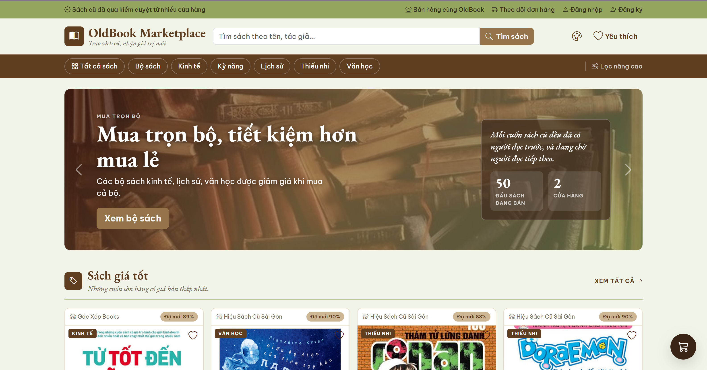
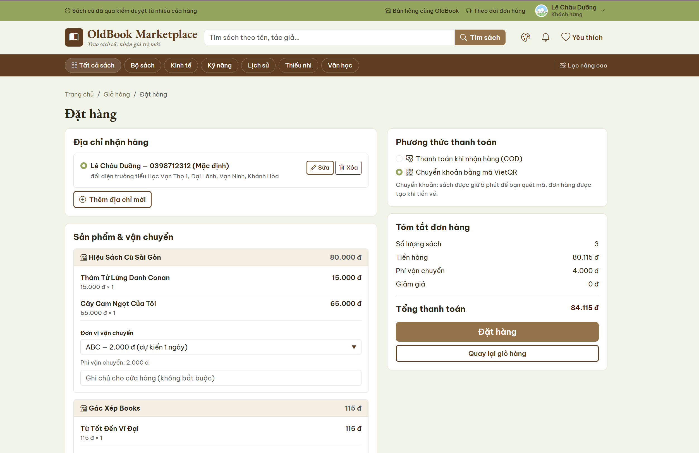
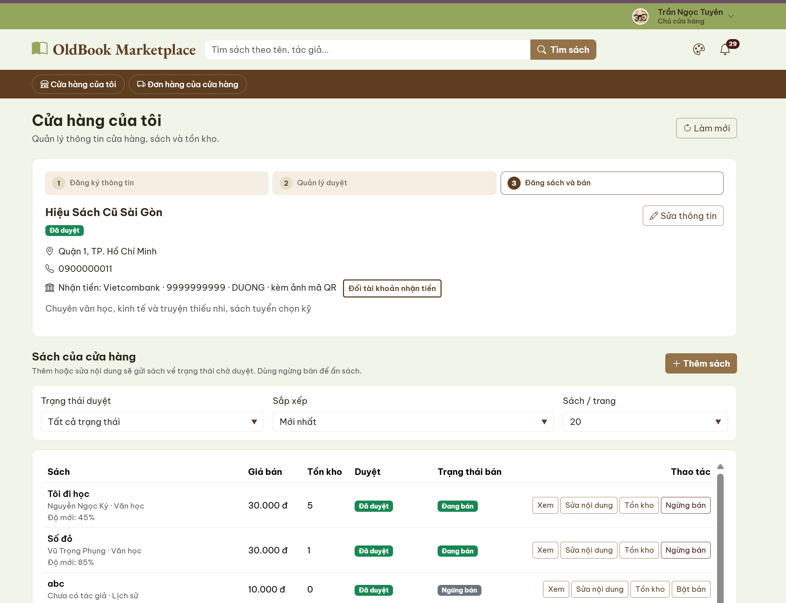
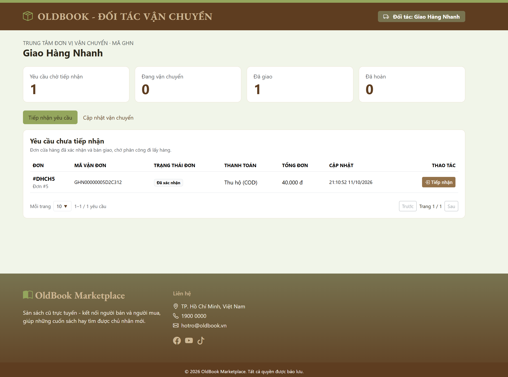
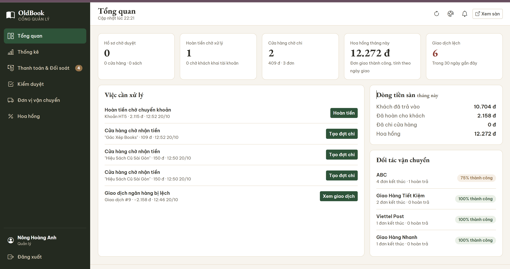
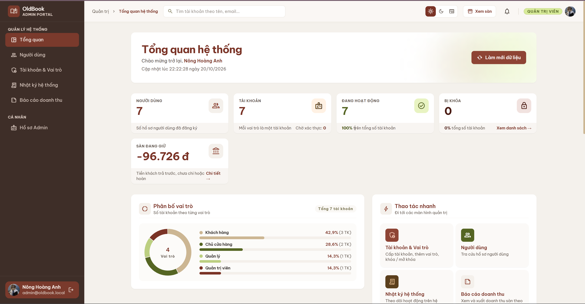

# OldBook Marketplace

> **Đề tài:** Xây dựng website quản lý chuỗi cửa hàng sách cũ  
> **Đồ án môn học:** Công nghệ phần mềm (Học kỳ I, năm học 2026–2027), mã lớp SOEN330679_08  
> **Đơn vị đào tạo:** Khoa Công nghệ thông tin, Trường Đại học Công nghệ Kỹ thuật TP. Hồ Chí Minh  
> **Giảng viên hướng dẫn:** ThS. Nguyễn Trần Thi Văn  
> **Nhóm thực hiện:** Nhóm 09


---
## Thông tin đồ án
| | |
|---|---|
| Trường | Đại học Công nghệ Kỹ thuật TP.HCM, Khoa Công nghệ thông tin |
| Môn học | Công nghệ phần mềm (mã lớp SOEN330679_08) |
| Học kỳ | Học kỳ I, năm học 2026 – 2027 |
| Giảng viên hướng dẫn | Th.S Nguyễn Trần Thi Văn |
## Thành viên nhóm

| STT | Họ và tên | MSSV | Liên hệ (Email) |
| :---: | :--- | :--- | :--- |
| 1 | Nông Hoàng Anh | 24110154 | 24110154@student.hcmute.edu.vn |
| 2 | Lê Châu Dưỡng | 24110189 | 24110189@student.hcmute.edu.vn |
| 3 | Nguyễn Ngọc Minh Thư | 24110347 | 24110347@student.hcmute.edu.vn |
| 4 | Trần Ngọc Tuyên | 24110373 | 24110373@student.hcmute.edu.vn |

---

## Giới thiệu chung

**OldBook Marketplace** là sàn mua bán sách cũ nhiều người bán (multi-vendor), xây dựng bằng **Spring Boot**, **Thymeleaf** và **Bootstrap 5**. Nhiều cửa hàng đăng sách trên cùng một sàn; khách đặt một đơn gồm sách của nhiều cửa hàng, hệ thống tách thành đơn con cho từng cửa hàng, sàn thu hoa hồng theo danh mục và chi lại doanh thu cho cửa hàng.

Hệ thống có sáu vai trò: **Khách vãng lai**, **Khách hàng**, **Chủ cửa hàng**, **Đơn vị vận chuyển**, **Quản lý** và **Quản trị viên**. Dự án tích hợp **thanh toán chuyển khoản VietQR** (xác nhận tiền về qua Casso), **thông báo thời gian thực bằng WebSocket**, **xác thực OTP qua email** và **lưu ảnh, video trên Cloudinary**.

---

## Cấu trúc thư mục

```bash
rebook-marketplace/
├── src/
│   ├── main/
│   │   ├── java/com/oldbook/
│   │   │   ├── OldbookMarketplaceApplication.java
│   │   │   ├── config/               # Cấu hình Spring: bảo mật, WebSocket, thanh toán, vận chuyển, Cloudinary
│   │   │   ├── controller/           # API REST (/api/**) và controller trả trang HTML
│   │   │   │   ├── admin/            # Quản trị viên: dashboard, báo cáo, nhật ký
│   │   │   │   ├── auth/             # Đăng nhập, đăng ký, OTP, quên mật khẩu
│   │   │   │   ├── catalog/          # Sách, tìm kiếm, đánh giá, yêu thích
│   │   │   │   ├── identity/         # Hồ sơ, địa chỉ, tài khoản và vai trò
│   │   │   │   ├── management/       # Cổng Quản lý: tổng quan, thống kê, hoa hồng
│   │   │   │   ├── notification/     # Thông báo
│   │   │   │   ├── order/            # Giỏ hàng, đặt hàng, đơn của cửa hàng
│   │   │   │   ├── payment/          # VietQR, webhook Casso, hoàn tiền, chi tiền
│   │   │   │   ├── shipping/         # Đơn vị vận chuyển và cổng đối tác
│   │   │   │   └── store/            # Cửa hàng, sách của cửa hàng, kiểm duyệt
│   │   │   ├── service/              # Nghiệp vụ, cùng cách chia phân hệ như controller (thêm media/)
│   │   │   ├── entity/               # Entity JPA (31 bảng)
│   │   │   ├── repository/           # Spring Data JPA
│   │   │   ├── dto/  constant/  exception/  filter/  security/
│   │   ├── resources/
│   │   │   ├── templates/
│   │   │   │   ├── admin/            # Trang Quản trị viên
│   │   │   │   ├── management/       # Cổng Quản lý
│   │   │   │   ├── payment/          # Quét mã, hoàn tiền, quản lý thanh toán
│   │   │   │   ├── shipping/         # Cổng đơn vị vận chuyển
│   │   │   │   ├── auth/  books/
│   │   │   │   └── fragments/        # Header, footer, khung trang dùng chung
│   │   │   ├── static/
│   │   │   │   ├── css/              # style.css, manager.css, admin-theme.css
│   │   │   │   └── js/               # JavaScript từng trang
│   │   │   └── application.properties
│   └── test/
│       ├── java/                     # Test tích hợp, test đơn vị, DemoDataSeeder (dữ liệu mẫu)
│       └── js/                       # Test giao diện chạy bằng Node
├── docs/                             # Tài liệu từng phân hệ (tên file chữ thường, nối bằng gạch ngang)
│   ├── images/                       # Ảnh dùng trong README
│   └── payment/                      # Script giả lập Casso đi kèm payment.md
├── .env.example                      # Mẫu cấu hình (chép thành .env)
├── pom.xml
├── mvnw / mvnw.cmd
└── README.md
```

---

## Tính năng chính

- Tìm kiếm, lọc sách cũ theo danh mục, giá, độ mới, đánh giá
- Giỏ hàng, sách yêu thích, sách đã xem gần đây
- Đặt một đơn gồm sách của nhiều cửa hàng; thanh toán COD hoặc chuyển khoản VietQR
- Theo dõi đơn hàng, hủy đơn, đánh giá kèm ảnh và video
- Cửa hàng tự quản lý sách, tồn kho và đơn hàng; sách và cửa hàng phải qua kiểm duyệt
- Cổng riêng cho đơn vị vận chuyển cập nhật trạng thái giao hàng
- Cổng Quản lý: tổng quan, thống kê vận hành, hoa hồng theo danh mục, hoàn tiền và chi tiền cho cửa hàng
- Trang Quản trị: tài khoản và vai trò, nhật ký hệ thống, báo cáo doanh thu sàn
- Thông báo thời gian thực qua WebSocket
- Xác thực tài khoản bằng OTP qua email, bảo mật bằng JWT
- Ba giao diện Mặc định, Tối, Tạp chí dùng chung cho mọi khu vực

---

## Tính năng chi tiết

### 1. Trang chủ và mua sắm

Trang chủ giới thiệu sách giá tốt, sách mới và bộ sách theo chủ đề.



- Tìm kiếm theo tên sách, tác giả; lọc theo danh mục, khoảng giá, độ mới, số sao
- Xem chi tiết sách với nhiều ảnh, thông tin cửa hàng và đánh giá của người mua
- Thêm vào giỏ hàng hoặc danh sách yêu thích; lưu lại sách đã xem

### 2. Đặt hàng và thanh toán

Một đơn có thể gồm sách của nhiều cửa hàng; hệ thống tách thành đơn con để từng cửa hàng xử lý riêng.



- **COD:** đơn vị vận chuyển thu hộ khi giao
- **Chuyển khoản VietQR:** hệ thống giữ sách 5 phút và hiện mã QR tới tài khoản của sàn; đơn chỉ được tạo khi Casso báo tiền về
- Hủy đơn hoặc gửi yêu cầu hủy; đơn đã trả tiền được hoàn về tài khoản khách đã dùng để chuyển, hoặc tài khoản khách chọn

### 3. Cửa hàng (Chủ cửa hàng)



- Đăng ký cửa hàng, khai tài khoản ngân hàng hoặc ảnh QR để nhận tiền
- Đăng sách (tối đa 10 ảnh), cập nhật tồn kho, bật hoặc ngừng bán
- Xác nhận đơn, hủy đơn, xử lý yêu cầu hủy của khách

### 4. Vận chuyển (Đơn vị vận chuyển)



- Mỗi đơn vị có cổng riêng tại `/shipping/{mã đơn vị}`
- Tiếp nhận đơn, cập nhật hành trình, giao thành công hoặc hoàn trả
- Trạng thái cập nhật tới khách và cửa hàng theo thời gian thực

### 5. Cổng Quản lý

Dashboard có sidebar; chuyển mục không tải lại trang, số liệu tự cập nhật khi có việc mới.



- **Tổng quan:** việc chờ duyệt, khoản cần hoàn, khoản cần chi, hoa hồng tháng, giao dịch lệch
- **Thống kê vận hành:** dòng tiền sàn, theo cửa hàng, theo đơn vị vận chuyển, hủy và hoàn, theo danh mục
- **Thanh toán và đối soát:** chi gộp nhiều đơn của một cửa hàng trong một lần chuyển, hoàn tiền cho khách, sổ giao dịch ngân hàng
- **Kiểm duyệt** cửa hàng và sách; **đối tác vận chuyển**; **hoa hồng** theo danh mục kèm lịch sử thay đổi

### 6. Quản trị hệ thống (Quản trị viên)



- Tra cứu người dùng; tạo tài khoản, cấp thêm vai trò, khóa và mở khóa
- Nhật ký hệ thống, lọc và xuất CSV
- Báo cáo doanh thu sàn, dòng tiền, doanh thu theo danh mục; chỉ xem và xuất CSV

### 7. Bảo mật

- Xác thực bằng JWT, mật khẩu băm BCrypt
- Phân quyền theo vai trò ở mọi API; một người dùng có nhiều vai trò thì mỗi vai trò là một tài khoản riêng
- Webhook thanh toán chỉ nhận yêu cầu có chữ ký HMAC-SHA512 hợp lệ
- Thao tác duyệt, khóa tài khoản, đổi hoa hồng đều ghi nhật ký hệ thống

---

## Công nghệ sử dụng

| Thành phần | Công nghệ | Phiên bản | Mô tả |
| :--- | :--- | :--- | :--- |
| **Ngôn ngữ** | Java | 21 | Backend |
| **Framework** | Spring Boot | 4.1.1 | Web MVC, Data JPA, Validation, Mail |
| **Template** | Thymeleaf | 3.1 | Kết xuất trang web |
| **Giao diện** | Bootstrap / Tailwind CSS | 5.3 / CDN | Bootstrap cho trang sàn và cổng Quản lý, Tailwind cho trang Quản trị |
| **Database** | SQL Server | — | Lưu trữ dữ liệu; H2 dùng cho test và chạy thử |
| **Bảo mật** | Spring Security | 7 | Xác thực, phân quyền |
| **JWT** | JJWT | 0.13.0 | Token đăng nhập |
| **Lưu ảnh** | Cloudinary | 2.0.0 | Ảnh sách, ảnh đại diện, ảnh và video đánh giá |
| **Thời gian thực** | Spring WebSocket | 4.1.1 | Thông báo, cập nhật đơn hàng |
| **Thanh toán** | VietQR + Casso | Webhook V2 | Mã QR chuyển khoản, xác nhận tiền về |
| **Email** | Spring Mail (Gmail SMTP) | 4.1.1 | OTP, quên mật khẩu |
| **Build** | Maven Wrapper | — | Không cần cài Maven |

---

## Cài đặt và chạy dự án

### Yêu cầu hệ thống

- Java Development Kit (JDK) 21
- SQL Server (không cần nếu chỉ chạy thử với dữ liệu mẫu)
- Node.js (chỉ để chạy test giao diện và script giả lập thanh toán)
- IDE: IntelliJ IDEA, Eclipse hoặc VS Code

### Hướng dẫn cài đặt

**Bước 1: Clone repository**

```bash
git clone https://github.com/anhh76612-ops/rebook-marketplace.git
```

```bash
cd rebook-marketplace
```

**Bước 2: Tạo database**

Chạy trong SQL Server Management Studio (thay mật khẩu):

```sql
CREATE DATABASE oldbook_db;
GO
CREATE LOGIN oldbook WITH PASSWORD = '<mật khẩu>';
GO
USE oldbook_db;
CREATE USER oldbook FOR LOGIN oldbook;
ALTER ROLE db_datareader ADD MEMBER oldbook;
ALTER ROLE db_datawriter ADD MEMBER oldbook;
ALTER ROLE db_ddladmin ADD MEMBER oldbook;
```

Bảng được tạo tự động ở lần chạy đầu (`spring.jpa.hibernate.ddl-auto=update`).

**Bước 3: Tạo file `.env`**

Chép `.env.example` thành `.env` ở thư mục gốc rồi điền giá trị. File này được nạp như file properties và **không** đưa lên git.

| Khóa | Bắt buộc | Ý nghĩa |
| :--- | :--- | :--- |
| `DB_URL`, `DB_USERNAME`, `DB_PASSWORD` | Có | Kết nối SQL Server |
| `MAIL_USERNAME`, `MAIL_PASSWORD` | Có | Gmail gửi OTP; dùng **mật khẩu ứng dụng** của Gmail |
| `CLOUDINARY_CLOUD_NAME`, `CLOUDINARY_API_KEY`, `CLOUDINARY_API_SECRET` | Để tải ảnh | Thiếu thì không tải được ảnh |
| `payment.bank.bin`, `payment.bank.account-no`, `payment.bank.account-name` | Để bật chuyển khoản | Tài khoản ngân hàng của sàn; bỏ trống thì chỉ còn COD |
| `payment.casso.checksum-key` | Đi kèm chuyển khoản | Khóa kiểm chữ ký webhook Casso |
| `payment.session-minutes` | Không | Thời gian giữ hàng và mã QR, mặc định 5 phút |

- Trong `.env`, khóa thanh toán viết **có dấu chấm** như trên. Trên máy chủ thì đặt biến môi trường viết hoa: `PAYMENT_BANK_BIN`, `PAYMENT_BANK_ACCOUNT_NO`, `PAYMENT_BANK_ACCOUNT_NAME`, `PAYMENT_CASSO_CHECKSUM_KEY`.
- `jwt.secret` trong `application.properties` chỉ dùng cho máy local; khi deploy phải đặt khóa khác qua biến `JWT_SECRET`.
- Sửa `.env` xong phải khởi động lại ứng dụng.

**Bước 4: Chạy ứng dụng**

```bash
./mvnw spring-boot:run
```

Trên Windows dùng `mvnw.cmd spring-boot:run`, hoặc chạy `OldbookMarketplaceApplication.java` từ IDE.

**Bước 5: Truy cập ứng dụng**

| Khu vực | Địa chỉ |
| :--- | :--- |
| Trang sàn | http://localhost:8080 |
| Cổng Quản lý | http://localhost:8080/management |
| Trang Quản trị | http://localhost:8080/admin/dashboard |
| Cổng đơn vị vận chuyển | http://localhost:8080/shipping/{mã đơn vị} |

Tài khoản Quản trị viên đầu tiên: đăng ký một tài khoản bình thường trên web, rồi cấp vai trò `QUAN_TRI_VIEN` trực tiếp trong database. Sau đó Quản trị viên cấp vai trò cho người khác trên trang **Tài khoản & Vai trò**.

### Chạy thử với dữ liệu mẫu

Không cần SQL Server: ứng dụng dùng database H2 tạm, dữ liệu mất khi tắt.

```bash
./mvnw -q spring-boot:test-run "-Dspring-boot.run.profiles=test,catalog-test,demo" "-Dspring-boot.run.arguments=--server.port=18090"
```

Mở http://localhost:18090. Tài khoản mẫu:

| Vai trò | Email |
| :--- | :--- |
| Quản trị viên | `admin@oldbook.test` |
| Quản lý | `quanly@oldbook.test` |
| Khách hàng | `khach@oldbook.test` |
| Khách hàng + Chủ cửa hàng | `nguoiban@oldbook.test` |

Mật khẩu chung ghi ở đầu file `src/test/java/com/oldbook/DemoDataSeeder.java`; chỉ có giá trị trong database tạm này.

---

## Thanh toán chuyển khoản

Tiền khách trả vào **tài khoản của sàn**; đơn chỉ được tạo khi ngân hàng báo tiền về qua Casso. Khi đơn giao thành công, sàn trừ hoa hồng rồi Quản lý chi lại cho cửa hàng; đơn hủy hoặc giao không thành công thì Quản lý hoàn tiền cho khách. Việc chuyển tiền đi là chuyển tay; hệ thống dựng mã VietQR và ghi sổ.

Trên máy local, Casso không gọi tới được, nên dùng script giả lập tiền về:

```bash
node docs/payment/gia-lap-casso.cjs <mã OB...> <số tiền> [cổng]
```

Hướng dẫn đầy đủ, từ cấu hình đến thử trên giao diện và nối Casso thật: [docs/payment.md](docs/payment.md). Khi deploy, webhook Casso trỏ tới `https://<địa chỉ web>/api/payment/casso/webhook`.

---

## Kiểm thử

Test Java (JUnit, chạy trên H2):

```bash
./mvnw -q test
```

Test giao diện (Node, không cần trình duyệt), chạy từng file:

```bash
node src/test/js/api-ui.test.cjs
```

---

## Tài liệu

| File | Nội dung |
| :--- | :--- |
| [docs/auth.md](docs/auth.md) | Tài khoản, vai trò, đăng ký OTP, đăng nhập, phân quyền |
| [docs/catalog-store.md](docs/catalog-store.md) | Sách, cửa hàng, kiểm duyệt |
| [docs/order.md](docs/order.md) | Giỏ hàng, đặt hàng, đơn hai cấp |
| [docs/order-cancel.md](docs/order-cancel.md) | Hủy đơn, ảnh hưởng tồn kho và thanh toán |
| [docs/payment.md](docs/payment.md) | Thanh toán VietQR, hoàn tiền, chi tiền, nối Casso |
| [docs/shipping.md](docs/shipping.md) | Vận chuyển và cổng đối tác |
| [docs/management.md](docs/management.md) | Cổng Quản lý: tổng quan, thống kê, chi gộp, hoa hồng, cập nhật thời gian thực |
| [docs/admin.md](docs/admin.md) | Trang Quản trị: tài khoản, nhật ký, báo cáo, giao diện |
| [docs/frontend-api.md](docs/frontend-api.md) | Trang giao diện và API mỗi trang gọi |

---

## Liên hệ

- GVHD: ThS. Nguyễn Trần Thi Văn
- SVTH: Nhóm 09 (danh sách ở mục [Thành viên nhóm](#thành-viên-nhóm))
- Repository: https://github.com/anhh76612-ops/rebook-marketplace

---

*Đồ án môn Công nghệ phần mềm – Trường Đại học Công nghệ Kỹ thuật TP. Hồ Chí Minh*
